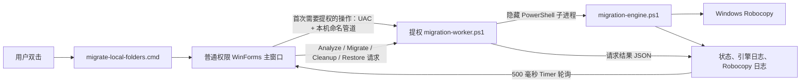

# 项目概览与代码审查

本文介绍 mklinktool 的运行结构、仓库文件职责和本次静态代码审查结果。程序目标是把用户选择的目录复制到本地固定磁盘，在校验后将原位置替换成目录 `SymbolicLink`。迁移前应关闭会写入来源目录的应用。

## 仓库文件索引

| 文件 | 类型 | 用途 |
|---|---|---|
| `migrate-local-folders.cmd` | 运行入口 | 双击启动 Windows PowerShell 5.1 STA 主窗口；隐藏 PowerShell 控制台，本身不提权。 |
| `migrate-local-folders.ps1` | GUI 主程序 | 提供 WinForms 窗口、目录选择/拖放、多选和右键操作、目标路径预览、预检、迁移与“清理失败副本”按钮；通过命名管道控制提权 Worker，并用 WinForms Timer 刷新任务状态。启动时检查工具目录权限和中断恢复记录。 |
| `migration-worker.ps1` | 提权 Worker | 首次需要提权的操作时由主程序请求 UAC 启动；验证管理员令牌、命名管道对端 PID 和固定协议，在主窗口会话期间复用，并为 Analyze/Migrate/Cleanup/Restore 启动引擎子进程。 |
| `migration-engine.ps1` | 迁移引擎 | 执行预检、磁盘空间检查、非穿透目录快照、Robocopy、文件/链接比较、来源备份改名、顶层符号链接创建、链接验证、回滚和备份清理；另提供清理失败遗留的目标副本、恢复中断迁移两个动作，改动类动作之间以全局互斥锁串行。 |
| `tests\Invoke-AllTests.ps1` | 测试入口 | 依次运行静态检查、引擎测试与两组 GUI 测试并汇总结果，有失败时退出码为 1；`-IncludeElevated` 再加一组提权测试（需要点一次 UAC）。需要 Windows PowerShell 5.1、开发者模式（或管理员身份）和桌面会话。 |
| `tests\TestHelpers.ps1` | 测试 | 各测试共用的断言、摘要与安全删除测试目录的函数。 |
| `tests\Test-Static.ps1` | 测试 | 所有 `.ps1` 语法与 UTF-8 BOM、`.cmd` 纯 ASCII。 |
| `tests\Test-Engine.ps1` | 测试 | 引擎端到端与故障注入：正常迁移、写入检测、回滚与提交点、备份删除失败提示、跨任务冲突、清理失败副本、中断恢复、互斥锁。 |
| `tests\Test-Gui.ps1`、`tests\gui\` | 测试 | 把 GUI 脚本副本与测试主体组合后在屏幕外运行，三种模式：`Fake`（`GuiTests.Body.ps1` + `FakeWorker.ps1`：轮询时序、确认丢失跟踪、引擎存活判断、失败副本记录、旧会话目录清理）；`RealWorker`（`WorkerTests.Body.ps1`：真实 Worker 与引擎以普通权限跑预检、迁移、清理、恢复与确认丢失）；`Elevated`（同一主体，Worker 经真实 UAC 提权，另验证嵌套目录符号链接）。`GuiHarness.ps1` 是共用函数。 |
| `README.md` | 用户文档 | 介绍安装前提、使用方式、目录布局、迁移与恢复流程及已知限制。 |
| `DESIGN.md` | 架构文档 | 记录组件关系、Worker 管道信任边界、迁移状态流程和安全决策。 |
| `PROJECT_OVERVIEW.md` | 项目索引/审查 | 当前文件职责、运行调用链、审查发现和覆盖范围。 |
| `AGENTS.md` | 维护者笔记 | 面向维护者与 AI 代理的约定和踩坑记录：编码与换行规则、PowerShell 5.1/.NET Framework 陷阱、测试方法、已知边界。改动脚本前先读。 |
| `operation-notes.md` | 历史操作记录 | 保存 2026-09-27 一次实际迁移的结果；不是默认作业清单，也不能作为重跑脚本。 |
| `PLAN_single_window_drag_drop.md` | 已实施计划 | 记录普通权限单窗口、直接拖放和常驻提权 Worker 的确认方案及历史验收情况。 |
| `PLAN_source_path_context_menu_drag_drop.md` | 已被取代的计划记录 | 留存双窗口收件箱方案的历史背景；当前右键菜单和多选仍由主窗口实现，旧接收窗方案已不使用。 |
| `plan-nested-junction-support.md` | 链接支持设计记录 | 记录内部目录 Junction/SymbolicLink 的边界、快照、Robocopy 和清理设计；不是程序入口。 |
| `PLAN_project_review_and_file_documentation.md` | 文档审查计划 | 记录早期文档审查范围、用户确认和验收约束；不参与程序运行。 |
| `PLAN_bug_summary_and_fixes.md` | 第一轮问题清单（历史） | 2026-10-12 的问题总结与修复方案（F1–F15）；其中多项结论已被第二轮计划更正，以第二轮为准。 |
| `PLAN_bug_review_round2.md` | 第二轮复核计划与执行记录 | 2026-10-13 复核结论（含实测记录、对上一轮结论的更正）、已确认的修复范围、2026-10-14 执行记录、2026-10-15 第三轮检查与修复记录，以及 2026-10-16 的临时目录清理与测试入库记录；未修复项的后续计划也在其中。 |
| `.gitignore` | Git 配置 | 忽略本地启动日志 `migrate-local-folders-launch.log` 与本地 IDE 目录 `.trae/`。 |
| `.gitattributes` | Git 配置 | 仓库内统一存 LF；`.ps1`、`.cmd` 检出为 CRLF。 |

当前工作目录中出现的 `migrate-local-folders-launch.log` 是被忽略的本地文件；现有启动器没有引用或写入它。`.trae/` 是本地 IDE 生成的目录，同样被忽略。`.git` 是 Git 自身的元数据目录，不是程序模块。

## 运行调用链

1. 启动器以普通权限打开唯一的 GUI；拖放只把目录路径加入列表，不移动文件。
2. 第一次需要提权的操作时，GUI 创建本机命名管道（ACL 仅授予当前用户与 Administrators）并启动提权 Worker。两端检查对方进程 PID；Worker 只接受带版本号的固定消息：`Execute`（动作限 `Analyze`/`Migrate`/`Cleanup`/`Restore`）与 `Shutdown`。
3. Worker 以隐藏子进程运行迁移引擎。引擎状态与日志写入当前用户 `%TEMP%\mklinktool-<GUID>` 会话目录；GUI 定时读取它们（日志按字节增量、共享读取），按引擎回写的序号匹配各行，不在 UI 线程扫描目录或等待 Robocopy。每次轮询先判定任务是否结束，再读取进度，保证结束时读到最终状态；没收到 Worker 的任务确认时界面保持锁定，跟踪结果文件直到任务确实结束。
4. 预检、迁移、清理与恢复共用当前 Worker。窗口正常关闭时通知空闲 Worker 退出；Worker 异常退出后再次操作可能再次显示 UAC。
5. 迁移开始前，GUI 在 `%LOCALAPPDATA%\mklinktool\pending` 写入中断恢复记录；下次启动时只对“备份存在、原路径为空”的项提示恢复。

## 迁移阶段与保护边界

1. **预检**：验证绝对路径、磁盘根限制、已有目标/备份、来源/目标包含关系、固定磁盘空间和顶层链接创建能力；手动递归扫描普通目录，不进入嵌套重解析点目标。
2. **复制与比较**：Robocopy 使用 `/SJ /SL` 保留受支持的嵌套目录 Junction/SymbolicLink 本身，不展开链接目标。比较相对文件路径、文件数、每个文件的大小与修改时间及链接相对路径/类型/目标；SHA-256 为可选项。复制参数不保留 ACL 安全描述符。
3. **来源切换**：校验后将来源改名为同级 `<来源名>_migration_backup`，在原路径创建顶层目录 `SymbolicLink`，再验证链接类型、目标和访问能力，并复核改名后的备份与校验时的来源一致。
4. **完成或恢复**：建链、验链或复核失败时，移除目标匹配的本次链接并尝试改名恢复来源；全部通过后按界面选项删除或保留备份。清理备份会先逐项删除重解析点本身，再清理剩余目录树。

外部或失效的嵌套链接、文件链接和未知重解析点会被拦截。内部绝对目标链接依赖原来源路径持续保留为顶层 SymbolicLink；若删除或改动该顶层链接，目标树内的绝对链接可能失效。所有来源会先完成预检；不同来源不是一个全局事务，某项失败不会撤销之前已成功的项。

## 代码审查发现

下表是 2026-09-28 静态审查的结论，并标注了截至 2026-10-15 的处理状态。之后两轮复核的完整问题清单、实测记录与修复情况见 `PLAN_bug_summary_and_fixes.md`（第一轮）与 `PLAN_bug_review_round2.md`（第二轮）。

| 优先级 | 位置 | 发现与影响 | 状态 |
|---|---|---|---|
| P2 | `migration-engine.ps1`：`Get-MigrationAnalysis` 与 `Invoke-Migration` | 预检没有检查目标是否等于或包含计划中的 `<来源>_migration_backup`；自定义目标与备份名冲突时，预检可能通过。 | 已修复：备份路径与所有来源、目标的互相包含检查均已纳入预检，冲突会标在相关行上。 |
| P2 | `migration-engine.ps1`：快照比较、来源改名和备份清理顺序 | 来源/目标快照在来源改名之前比较；比较之后仍写入来源的内容不会进入目标副本，默认清理备份时可能丢失。工具不检测进程或持续写入。 | 已修复（2026-10-15，第二轮计划 N5）：快照记录修改时间并纳入比较；建链后、提交前复核改名后的备份，有变化就回滚。残余：改名后仍持有句柄的应用在复核之后的写入、修改时间推迟到关闭才更新的同大小原地改写，仍需靠“先关闭相关应用”。 |
| P2 | `migrate-local-folders.ps1`：`Start-Worker` 与按钮事件处理器 | 启动阶段失败时状态复位不完整。 | 已修复：启动失败不再清空原有结果；被拒绝或未发出的请求会清理会话目录与中断恢复记录；请求已发出但没收到确认时进入跟踪模式，任务确实结束后才解锁（2026-10-15，第二轮计划 F5）。 |
| 隐私提示（当前文件已处理） | `README.md`、`operation-notes.md`、`plan-nested-junction-support.md` | 先前的示例/历史记录包含账户目录名、具体应用目录和逐目录数据量。公开仓库会因此暴露个人环境细节。 | 当前文件已改用 `%USERPROFILE%` 和通用目录示例，移除历史应用名称、逐目录文件数/字节数及精确磁盘容量；以前的 Git 提交仍保留旧内容，如需从公开分支历史中移除，需要另行确认历史重写。 |

## 覆盖范围与限制

- 自动化测试在 `tests/`（2026-10-16 入库，`tests\Invoke-AllTests.ps1` 一次运行，约 50 秒），没有 CI 工作流。提权流程有半自动测试（`-IncludeElevated`，需要点一次 UAC），2026-10-16 在修复 F10 前后各运行一次，均全部通过。仍需人工验证的是：“以另一个管理员账号提权”（需要该账号的密码）、右键菜单弹出位置、启动时中断恢复提示的弹窗交互。测试方法（故障注入、GUI 屏幕外运行、假 Worker 进程、真实 Worker 的普通权限副本、用进程 ACL 模拟完整性级别）记录在 `AGENTS.md`。
- 本次 `verify-security` 脚本扫描了 0 个源文件，因为它的规则不覆盖 `.ps1` 和 `.cmd`；因此不能将扫描结果解释为 PowerShell 代码通过安全扫描。Worker 的管道 ACL、双方 PID 校验、管理员令牌检查、固定消息类型和会话路径限制已作人工检查，但这不是正式渗透测试。
- 本次审查是静态代码阅读；PowerShell 5.1 Parser 检查用于语法验证。未模拟交互式 UAC/Explorer 拖放，也未在真实来源目录或目标目录运行迁移。
- 目标空间预检按来源字节数估算并额外保留 1 GB；SHA-256 默认关闭。用户应结合目标卷空间、文件重要性和迁移时间决定是否开启哈希校验及是否保留备份。
